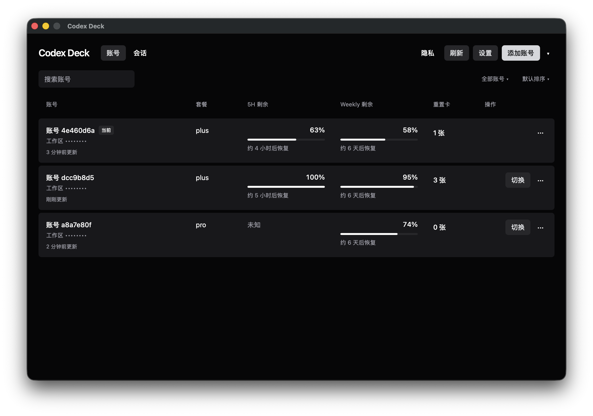

# Codex Deck

Codex Deck 是管理 Codex CLI 多个 ChatGPT 账号、套餐额度和重置卡的桌面应用。使用 Go、Wails、React 和 HeroUI，主题跟随系统。



## 核心能力

- 浏览器登录、重新登录，以及单账号 `auth.json` 导入、导出。
- 同步 CLI 当前账号，编辑别名、搜索与排序，切换账号时写入 CLI 文件凭据。
- 查看 5H、Weekly 剩余额度和恢复时间，后台刷新、缓存与认证失效提示。
- 查询与确认使用重置卡，结果未确定时沿用原请求重试。
- WebDAV 自动备份、冲突处理与整体恢复。
- 隐私模式、单实例、托盘驻留、可选开机自启动和低额度通知。
- 展示程序版本，检查正式版更新，确认后下载安装并重启。

## 安装与使用

从 [GitHub Releases](https://github.com/Sanjeever/codex-deck/releases) 下载对应平台的包，解压后运行。macOS 包包含完整 `.app`；Windows 和 Linux 包包含可执行文件。发布架构与运行依赖见 [开发与发布](docs/development.md)。

添加账号后可查看额度与执行账号操作。设置通过对话框打开，关闭窗口后仍驻留托盘，通过托盘“退出”结束进程。托盘不可用时，关闭窗口会退出，界面会提示原因。

应用配置、认证导入导出、CLI 切换、WebDAV 与桌面设置见 [使用指南](docs/usage.md)。配置和导出文件含明文登录凭据，请勿公开分享。

README 描述当前源码能力。某个安装包包含哪些功能，以对应发布标签与 Release Notes 为准。

## 开发入口

先按 [开发与发布](docs/development.md) 准备工具链和平台依赖，再在仓库根目录启动完整应用。

```sh
wails dev
```

单独构建前端并运行检查。

```sh
pnpm --dir frontend install --frozen-lockfile
pnpm --dir frontend build
pnpm --dir frontend test
go test ./...
```

Linux 的 WebKitGTK 构建标签、桌面构建、版本 bump、发布和验证边界见开发文档。单独启动 Vite 不包含 Go 后端。

## 项目结构

| 位置 | 职责 |
| --- | --- |
| 根目录 Go 文件 | 桌面入口、Wails 绑定与系统交互 |
| `internal/deck` | 账号、认证、额度、持久状态与 WebDAV |
| `internal/autostart`、`internal/tray`、`internal/update` | 自启动、托盘与程序更新 |
| `frontend/src` | 应用控制、账号展示、对话框、消息和接口类型 |
| `build`、`scripts`、`.github/workflows` | 平台打包资源、版本工具与发布工作流 |

## 文档入口

- [使用指南](docs/usage.md)：配置、用户操作与兼容性限制。
- [架构与行为契约](docs/architecture.md)：设计理由、必须保留的约束与子系统边界。
- [开发与发布](docs/development.md)：工具链、构建、验证和发布操作。
- [AGENTS.md](AGENTS.md)：Coding Agent 的事实来源、上下文选择与完成标准。
